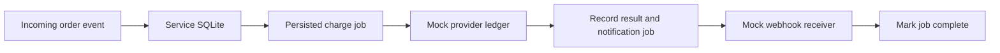

[README](README.md) · [English overview](README.en.md)

# How the example works

## Durable state and external effects

The service, mock provider, and mock notification receiver use separate SQLite databases. This keeps an external effect durable across a service restart without relying on shared application memory.

`Workflow.ingest` stores an order and its charge job within one database transaction. Duplicate input is checked by event identifier and payload hash; a different event referring to the same order also checks the order's amount and currency.

`Workflow.run_one` records an attempt and makes an external call outside the service transaction. The mock provider commits an idempotency key and payload hash in its own database. A worker can crash after that commit, or lose the response. Retrying the same key returns the existing reference.

The service then records the successful outcome and creates a notification job atomically. The receiver deduplicates the stable notification identifier. This matters when a worker crashes after delivery but before recording its acknowledgement.

Amounts are positive integers in minor currency units. The example has a single mock merchant and one worker; it does not process real money.

## Retry and exhaustion

Retries are deterministic opportunities in a bounded loop, with a maximum of three attempts. There are no wall-clock delays. A job reaching its limit becomes `dead` and requires an explicit recovery decision. An exhausted job can have an uncertain external outcome, so a real integration must reconcile with its provider before deciding what to do next.

## What the tests establish

The tests exercise duplicate input, conflicting identifiers, rollback if job creation fails, restart after an external effect, loss of a provider response, notification recovery, restart after notification delivery, retry exhaustion, provider payload conflicts, and invalid amounts.

GitHub Actions runs the tests and checks that a fresh demo reproduces the committed JSON and SVG reports on Python 3.11, 3.12, and 3.13.

## Boundaries for a real integration

This repository deliberately uses a small deterministic worker and local mocks. A deployed system additionally needs:

- A real provider contract, including the scope and lifetime of its idempotency keys.
- Worker coordination, job claiming, backoff, rate limits, and concurrent-worker tests.
- Timeouts and reconciliation for ambiguous outcomes and exhausted jobs.
- Authentication, authorization, validation, and signed notifications.
- Monitoring, operator tooling, retention rules, and deployment procedures.

The example demonstrates specific failure-handling behavior under its stated assumptions. It does not establish a universal exactly-once guarantee across arbitrary external systems.

## Files

| File | Purpose |
| --- | --- |
| `demo.py` | Service state, external mocks, scenarios, and report generation. |
| `test_demo.py` | Failure and consistency checks. |
| `examples/report.json` | Committed output of the three demonstration scenarios. |
| `assets/report.svg` | Visual report generated from the same run. |
| `.github/workflows/checks.yml` | Tests and report reproducibility checks. |

[Discuss your architecture with CKT Labs](mailto:nickolaychekotko@gmail.com).
