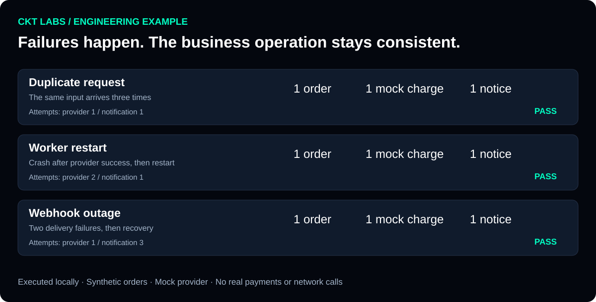

[Русский](README.md) · [CKT Labs](https://github.com/cktlabs) · [Client case studies](https://github.com/cktlabs/portfolio/blob/main/README.en.md)

# One order. One operation. Even after a failure.

**A runnable CKT Labs engineering example:** handling duplicate input, a worker restart, and a temporary external-service outage.

For a business, the question is simple: what happens to an order if a response is lost or someone clicks twice?



**Synthetic orders and a mock payment provider.** Everything runs locally, with no real payments, accounts, or network requests.

## What the example checks

| Situation | What the example does | Observed result |
| --- | --- | --- |
| The same request arrives three times | Recognizes the previously accepted input | 1 order, 1 operation in the mock provider. |
| The worker crashes after the external operation succeeds | Reuses the same operation key after restart | The provider returns the existing operation. |
| The notification receiver is temporarily unavailable | Retries delivery using a stable event identifier | The notification is accepted after recovery; the operation is not repeated. |

The image above is generated from an executed run. Reproduce the [machine-readable report](examples/report.json) with the command below.

## Run in a minute

Python 3.11 or newer; no third-party packages required.

```sh
git clone https://github.com/cktlabs/workflow-reliability-demo.git
cd workflow-reliability-demo
python demo.py
python -m unittest -v
```

The run writes `report.json` and a visual `report.svg` into `artifacts/`. Temporary SQLite databases isolate each scenario; running it again starts fresh scenarios.

## For technical leaders

- The order and the intent to call the provider commit in one transaction.
- Request and order identifiers are checked against the business payload.
- The independent mock provider keeps its own ledger and supports idempotent calls.
- Workers recover from persisted jobs; notifications use stable identifiers.
- Exhausted jobs enter a `dead` state rather than being reported as successful.

[Architecture, demo boundaries, and real integration considerations →](ENGINEERING.md)

## Where this pattern is relevant

Payment integrations, order creation, event processing, and notifications. Actual guarantees depend on external APIs and agreed recovery procedures.

**[Discuss your integration](mailto:nickolaychekotko@gmail.com)** · [Telegram](https://t.me/cktlabs) · [CKT Labs portfolio](https://github.com/cktlabs/portfolio/blob/main/README.en.md)
